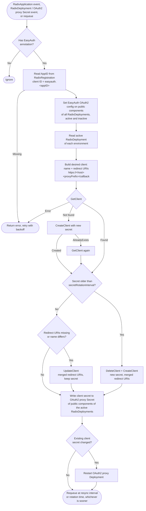

# Radix EasyAuth

Radix EasyAuth gives Radix applications authentication without any setup by the application team. When a
`RadixApplication` has the `easyauth.radix.equinor.com` annotation, every public component is put behind the
Radix OAuth2 proxy, which authenticates users against a Radix managed [Dex](https://dexidp.io/docs/) instance.
The annotation value must always be empty.

```yaml
apiVersion: radix.equinor.com/v1
kind: RadixApplication
metadata:
  name: my-app
  annotations:
    easyauth.radix.equinor.com: ""
    easyauth.radix.equinor.com/allowed-identities: "group-a,group-b"
```

### Allowed identities

Only members of the allowed groups get access to the public components. The groups are a comma separated list in
the `easyauth.radix.equinor.com/allowed-identities` annotation, for example `"group-a,group-b"`. Empty
groups (`"group-a,,group-b"`) and spaces around groups (`"group-a, group-b"`) are rejected. When the annotation is missing or empty,
[`config.oauth2.allowedGroups`](#configuration) is used. When the defaults are also empty, the `RadixApplication` is
rejected, so every application must choose its groups.

The groups are set as `allowedGroups` on the OAuth2 configuration of each public component, which radix-operator
passes to the OAuth2 proxy as `OAUTH2_PROXY_ALLOWED_GROUPS`. By default, oauth2-proxy reads groups from the `groups`
claim of the ID token; `config.oauth2.groupClaim` selects a different claim. The Dex connector must include that claim
(the `groups` scope is requested by default).
Users that log in but are not in any of the groups get `403 Forbidden` from the OAuth2 proxy.

The annotation only accepts groups. Selecting users may be added later, and will not be combinable with groups.

EasyAuth runs as a separate deployment, installed with the [radix-easyauth](../charts/radix-easyauth) Helm chart.
The `ghcr.io/equinor/radix/easyauth` image and the `oci://ghcr.io/equinor/radix/charts/radix-easyauth` chart are
built in pull requests, and published with the same version as radix-operator on each release.
It consists of:

| Part                | Status      | Responsibility                                                                                   |
| ------------------- | ----------- | ------------------------------------------------------------------------------------------------ |
| Mutating webhook    | Implemented | Overrides the OAuth2 configuration of public components                                          |
| RD mutating webhook | Implemented | Copies the annotation from the `RadixApplication` to new `RadixDeployments`                      |
| Validating webhook  | Implemented | Validates the annotations, and optionally rejects `RadixApplications` without the annotation     |
| Dex                 | Implemented | OIDC provider that users log in to, installed by the chart. Required                             |
| Controller          | Implemented | Keeps an OAuth2 client in Dex, the client secret and `RadixDeployments` in sync with each app    |
| Cleanup loop        | Implemented | Deletes Dex clients that no longer belong to an application, when `config.cleanupEnabled` is set |

The webhooks and the controller run in the same process and Deployment, so they always share configuration and
version. The webhooks are served by every replica, while the controller only runs on the leader. Since the webhooks
use `failurePolicy: Fail`, an unavailable EasyAuth blocks all creates and updates of `RadixApplications`, and all
creates of `RadixDeployments`. The chart
therefore defaults to 2 replicas, spread across nodes with a preferred pod anti-affinity (unless `affinity` is set),
and a PodDisruptionBudget with `minAvailable: 1` when `replicaCount` is greater than 1. The chart fails to render
if `config.enableLeaderElection` is `false` and `replicaCount` is greater than 1.

## Mutating webhook

Runs on create and update of `RadixApplications` with the annotation. For each public component (`publicPort`
set, or the deprecated `public: true`) it:

- Replaces `authentication.oauth2` with the EasyAuth configuration below. Everything except `clientId`,
  `credentials`, `oidc.issuerUrl` and `allowedGroups` comes from [`config.oauth2`](#configuration), the example shows
  the chart defaults. `allowedGroups` comes from the [allowed identities](#allowed-identities). `proxyPrefix` is set to `/oauth2` if `config.oauth2.proxyPrefix` is empty, instead of relying on the
  radix-operator default, since the controller must know the callback path to register redirect URIs in Dex.
- Removes `authentication.oauth2` from all `environmentConfig` entries, since environment configuration is merged
  on top of the component configuration by radix-operator.

Any OAuth2 configuration set by the user on a public component is overridden. Private components and jobs are not
changed, and `RadixApplications` without the annotation are left untouched. A `RadixApplication` with the annotation
but no [allowed identities](#allowed-identities) is rejected.

```yaml
authentication:
  oauth2:
    clientId: easyauth.<appID>
    credentials: secret
    allowedGroups:
      - group-a
      - group-b
    groupClaim: groups
    scope: openid profile email groups offline_access
    setAuthorizationHeader: false
    setXAuthRequestHeaders: false
    setUserHeaders: true
    sessionStoreType: systemManaged
    proxyPrefix: /oauth2
    oidc:
      issuerUrl: <config.issuerUrl>
```

The configuration is built in [`internal/oauth`](internal/oauth/oauth.go), which is shared with the controller:
`oauth.NewTemplate` builds the configuration without the client ID once at startup, and `oauth.Config` adds the
client ID of an application.

The webhook only rewrites the `RadixApplication`, it has no side effects (`sideEffects: None`). Everything that
talks to Dex or creates secrets belongs in the controller.

The client ID is described in [Client ID](#client-id). The webhook reads the `RadixRegistration` of the
application from the API server, not a cache, since it may have just been created. The request is rejected if the
`RadixRegistration` doesn't exist or has no AppID.

## RadixDeployment mutating webhook

Runs on create of `RadixDeployments` ([`RadixDeploymentDefaulter`](internal/defaulter/radixdeployment.go)). It reads
the `RadixApplication` of the app (`spec.appname`) from the API server, not a cache, since
the pipeline may have just applied it, and:

- Sets the annotation on the `RadixDeployment`, with the same value, if the `RadixApplication` has it.
- Removes the annotation from the `RadixDeployment` if the `RadixApplication` doesn't have it, or doesn't exist.
  This also removes an annotation copied from another `RadixDeployment`, for example when promoting.

Updates are not changed, so the annotation tells whether EasyAuth was enabled when the `RadixDeployment` was
created. The [cleanup loop](#cleanup-loop) uses it to keep a Dex client while an active `RadixDeployment` still
uses EasyAuth.

## Validating webhook

Rejects create and update of `RadixApplications` where:

- The annotation has a value. It must always be empty.
- The annotation is set, but there are no valid [allowed identities](#allowed-identities).
- The annotation is missing and `config.enforced` is `true`, making EasyAuth mandatory for all applications in the
  cluster.

The allowed identities annotation without the annotation gives a warning, since it has no effect.

## Controller

Reconciles `RadixApplications` with the annotation. `RadixApplications` without the annotation are ignored. For
each application it:

1. **Reads the AppID** from the `RadixRegistration` with the same name, and builds the [client ID](#client-id).
2. **Syncs the OAuth2 config to `RadixDeployments`.** Sets the OAuth2 configuration from the
   [mutating webhook](#mutating-webhook) on the public components of the active `RadixDeployment` in each
   environment of the application. This covers `RadixDeployments` created before the annotation was added.
   Inactive `RadixDeployments` are not changed. When one is promoted, the promote pipeline creates a new
   `RadixDeployment` in the target environment, which gets the OAuth2 config when it becomes active, since the
   controller watches activation. radix-operator redeploys active `RadixDeployments` when they change. The patch uses optimistic locking. On a conflict, the `RadixDeployment` is read again and the
   patch is retried with exponential backoff (up to 5 attempts, starting at 10ms and growing 5x).
   This runs before anything talks to Dex, since it only needs the client ID. A public component without the
   OAuth2 config is exposed without authentication, so protecting it must not wait for Dex. Until the client secret
   is synced, the OAuth2 proxy can't start and the component is unreachable instead of unprotected. If this step
   fails, the next steps still run, and the errors are returned together.
3. **Ensures the Dex client** with the [reconcile loop](#reconcile-loop), and gets the client secret from Dex.
4. **Syncs the client secret to public components.** For every public component of the active `RadixDeployment` in
   every environment, writes the client secret to the `ClientSecret` key of the OAuth2 proxy Secret
   (`<component>-aux-oauth-*`). The active `RadixDeployment` is used instead of the `RadixApplication`, since a
   component that was removed or made private in the `RadixApplication` still runs an OAuth2 proxy until the change
   is deployed. The OAuth2 proxy Secret is created by radix-operator when the component is deployed, and is skipped
   until it exists. Other keys, like `CookieSecret`, are not changed.
5. Requeues every hour to correct drift. Errors, for example when Dex is unavailable, are retried with backoff.

Only Secrets and `RadixDeployments` in the environment namespaces of the application's `RadixApplication` are
changed. The controller also watches `RadixDeployments` (spec changes and activation) and OAuth2 proxy Secrets,
mapped to their application by the `radix-app` label, so new deployments and hosts are handled without waiting for
the next resync. Only OAuth2 proxy Secrets (label `radix-aux-component-type=oauth`) are cached.

The OAuth2 proxy reads the client secret at startup. When the controller changes an existing client secret, for
example after the Dex client was recreated or the value was changed by a user, it restarts the OAuth2 proxy:

1. Sets the annotation `easyauth.radix.equinor.com/restart-pending` on the OAuth2 proxy Secret, in the same patch as
   the new client secret, so a failed restart is retried by the next reconcile.
2. Sets `easyauth.radix.equinor.com/restartedAt` on the pod template of the OAuth2 proxy Deployment
   (`<component>-aux-oauth`), which rolls the pods like `kubectl rollout restart`. This is the same as restarting
   the OAuth2 proxy in the Radix API, which uses `radixapi/restartedAt`.
3. Removes `restart-pending` from the Secret.

The OAuth2 proxy is not restarted when the client secret is set for the first time, since its container can't
start until the key exists, and starts with the new value when it does. radix-operator doesn't know about the
`restartedAt` annotation and removes it the next time it syncs the `RadixDeployment`, which rolls the pods once more.
The Deployment is patched without being read, so Deployments are not cached and EasyAuth only needs the `patch`
permission on them.

### Graceful shutdown

Once the controller has started syncing an application, it finishes the sync even if it is shut down, so the Dex
client, the client secret in the OAuth2 proxy Secrets and the OAuth2 proxy restarts are never left half-done:

- The manager cancels the context of running reconciles on shutdown, so each reconcile runs on a context that is not
  cancelled with it (`context.WithoutCancel`), bounded by `SyncTimeout` (30s) so a hanging API call can't block
  shutdown forever. No new reconciles are started after the shutdown signal.
- A secret rotation deletes the Dex client and creates it again. Once the client is deleted, it is created again on
  its own context with a 10s timeout, even if the sync has timed out, so the client is not left deleted.
- The manager waits up to `GracefulShutdownTimeout` (50s) for running reconciles before it releases the leader
  lease. The next leader doesn't start until the old one has finished.
- The Pod has `terminationGracePeriodSeconds: 60`, so Kubernetes doesn't kill the container before the manager has
  stopped. A second `SIGTERM`/`SIGINT` exits immediately.

Each step is safe to retry, so a sync that still fails, for example after a timeout or a crash, is completed by the
next reconcile. The [cleanup loop](#cleanup-loop) stops when it is shut down. Each client is deleted in a single
call, so a cleanup that is stopped partway doesn't leave anything half-done, and the rest is deleted on the next run.

## Dex

The chart always installs Dex, since EasyAuth stores OAuth2 clients in it:

| Resource                       | Purpose                                                                                        |
| ------------------------------ | ---------------------------------------------------------------------------------------------- |
| Deployment and Service         | Dex, with the HTTP (5556), gRPC API (5557) and telemetry (5558) ports                          |
| Secret `<fullname>-dex-config` | Dex configuration, rendered from `config.issuerUrl` and `dex.config`                           |
| HTTPRoute                      | Exposes Dex on the host and path of `config.issuerUrl`, attached to `dex.httpRoute.parentRefs` |
| Certificates                   | gRPC serving certificate for Dex, and a client certificate for EasyAuth                        |
| NetworkPolicy                  | Only EasyAuth pods can reach the gRPC port                                                     |
| ServiceAccount                 | Without a token or roles, except with Kubernetes storage, see **Storage** below                |

- **Issuer:** `config.issuerUrl` is both the Dex issuer and the issuer set on public components by the mutating
  webhook, so they always match. It overrides `issuer` in `dex.config`.
- **Storage:** Dex stores clients, signing keys and sessions in `dex.config.storage`, which supports every
  [storage](https://dexidp.io/docs/configuration/storage/) Dex supports. Production uses Postgres,
  shared by all clusters, see [Multiple clusters](#multiple-clusters). Secrets, like the database password, are
  added with `dex.extraEnv` and referenced as `$VAR`, which Dex expands in its config. With `type: kubernetes`:
  - Data is stored as custom resources, only meant for testing and local clusters. The data can't be shared
    between clusters, is lost with the cluster, and Dex warns that it doesn't scale to many users.
  - Dex creates its CRDs (`dex.coreos.com`) on startup if they are missing, so the chart mounts the service account
    token in the Dex pods, and grants a ClusterRole that can `create` CRDs and a Role for `dex.coreos.com`
    resources in the release namespace. The CRDs and their resources are not removed when the chart is
    uninstalled. Set `storage.config.inCluster: true` to use the release namespace.
  - Dex doesn't implement `ListClients` for Kubernetes storage, so the chart always sets `config.cleanupEnabled`
    to `false`.
- **Configuration:** connectors, logging and other settings come from `dex.config`, see the
  [example config](https://github.com/dexidp/dex/blob/master/examples/config-dev.yaml). It defaults to `logger`
  with level `info` and format `json`. `issuer`, `grpc` and `telemetry` are always set by the chart, and
  `web.http` is always set, but other `web` settings are merged.
  Secrets for connectors can be added with `dex.extraEnv` and referenced as `$VAR` in `dex.config`.
- **Routing:** `dex.httpRoute.parentRefs` is passed to the HTTPRoute as is, so it can reference a `Gateway`, a
  `ListenerSet`, or both.
- **gRPC authentication:** the gRPC serving certificate and the EasyAuth client certificate are issued by the
  chart's CA, the same CA as the webhook serving certificate. Dex requires a client certificate signed by this CA
  (`tlsClientCA`), and only accepts certificates with the `client auth` usage, so the webhook serving certificate
  can't be used as a client certificate. The client certificate is mounted in EasyAuth, and its location and the
  Dex gRPC address are added to the EasyAuth config as `dex.certsDir` and `dex.grpcAddress`.
- **Image entrypoint:** the container runs the `dex` binary directly instead of the image entrypoint, which
  renders the config with gomplate into `/tmp` and doesn't work with a read-only root filesystem.
- **Azure Workload Identity:** set `azure.workload.identity/client-id` in `dex.serviceAccount.annotations` and
  `azure.workload.identity/use: "true"` in `dex.podLabels`. The Workload Identity webhook projects its own token,
  so `dex.automountServiceAccountToken` can stay `false`, but it can be set to `true` if the Kubernetes API token
  is needed.

## Dex integration

Dex needs one OAuth2 client per application, with redirect URIs for every public host of the application. The
EasyAuth controller keeps these clients in sync using the [Dex gRPC API](https://dexidp.io/docs/configuration/api/).

### Why the gRPC API and not `staticClients`

- Dex reads `staticClients` from its config file at startup only, so every change requires a restart. During a
  rolling restart, Dex replicas disagree about which clients exist, and new applications can't log in until the
  next restart. Debouncing restarts reduces the number of restarts, but not these problems.
- Dex documents the gRPC API as the interface for management applications, and `staticClients` as a developer
  convenience.
- Clients created through the API are stored in Dex's database, which in production is a persistent Postgres
  database outside the cluster. They survive Dex restarts and are shared by all Dex replicas. Static clients are
  never stored in the database.
- Client secrets live in the Dex database and per application Secrets, instead of in one shared config object.

### Client ID

Each client is identified by the AppID of the application's `RadixRegistration` (`spec.appID`):

```text
easyauth.<appID>
```

The AppID is used instead of the application name because:

- **It is never reused.** An application name becomes available again when the application is deleted. With
  name based IDs, a new application with the same name would take over the old client, including its secret and
  redirect URIs, until cleanup removes it. With the AppID, a recreated application gets a new client, and the old
  client is an orphan that is harmless until it is removed. This is what makes it safe to clean up periodically
  instead of using a finalizer.
- **It is immutable** (enforced by the CRD) and unique across `RadixRegistrations` (enforced by radix-webhook), so
  a client ID never changes or collides during the lifetime of an application.

The client ID is built by `oauth.ClientIDForApp` in [`internal/oauth`](internal/oauth/oauth.go), which is used by
both the mutating webhook and the controller, so they always agree on the client ID.

The AppID is a ULID and doesn't tell a human which application a client belongs to, so the controller sets the
Dex client `name` to the application name. Dex shows the name on its approval screen, and it makes clients easy
to identify when debugging.

`spec.appID` is optional in the `RadixRegistration` CRD. All existing `RadixRegistrations` have one, and the
API server sets it on new registrations. The controller and webhook treat a missing AppID as an error for that
application instead of falling back to the name. A missing AppID can be added later, since the CRD immutability
rule only applies when the old object has a value.

### Reconcile loop



`RadixDeployment` sync errors don't stop the Dex steps; they are returned together with any Dex error at the end.

For each `RadixApplication` with the annotation, the controller:

1. Reads the AppID from the `RadixRegistration` with the same name, and syncs the OAuth2 config to
   `RadixDeployments`, see [Controller](#controller). Dex is only called after this.
2. Builds the desired client: the [client ID](#client-id), the application name as `name`, and a redirect URI
   `https://<host><proxyPrefix>/callback` for every public host of the active `RadixDeployment` in each environment
   of the application. `<proxyPrefix>` is the sanitized `proxyPrefix` of the EasyAuth OAuth2 config, `/oauth2` by
   default, built the same way as radix-operator builds the OAuth2 proxy redirect URL (`oauth.RedirectURI`). The
   hosts are built the same way as radix-operator builds the hosts of its HTTPRoutes, from
   `config.clusterName`, `config.dnsZone` and `config.appAliasBaseURL`: the cluster, active cluster, app alias and
   external DNS hosts of each public component, and the `dnsAlias` entries of the `RadixApplication` for the
   component and environment. Since the hosts don't depend on the HTTPRoutes, redirect URIs are in Dex before the
   routes are ready.
3. Calls `GetClient`:
   - Not found: generates a secret and calls `CreateClient`. If the client was created concurrently, for example by
     another cluster, it is read again with `GetClient`. Dex returns a missing client as gRPC `Unknown` with the
     message `not found`, which is handled the same as `NotFound`.
   - Found: calls `UpdateClient` if redirect URIs are missing or the name differs, and keeps the existing secret.
    Redirect URIs are replaced with hosts from every active RadixDeployment, including orphaned environments, plus
    aliases from the latest RadixApplication. If the secret is due for rotation, the client is rotated instead, see
    [Secret rotation](#secret-rotation).
   - Other errors: nothing is created, and the reconcile is retried.
4. Writes the client secret from Dex to the OAuth2 client secret of each public component of the active
   `RadixDeployment`, so the OAuth2 proxy can authenticate against Dex.
5. Requeues periodically to correct drift, or at the secret rotation time if that is sooner, and retries with
   backoff if Dex is unavailable.

`RadixApplications` without the annotation are ignored by the reconcile loop. Removing clients is handled only by
the cleanup loop below.

### Secret rotation

Client secrets are rotated when they are older than `config.secretRotationInterval`, 90 days by default.

The rotation interval is owned by the controller, and passed to `EnsureClient` of the Dex client manager
(`internal/dex`), which rotates the secret when it is due and returns when the next rotation is due.

- **Creation time:** Dex clients have no metadata, so the creation time is stored in the secret itself. A secret is
  a ULID, which encodes the creation time, followed by `.` and 128 bits of random data from `crypto/rand`. Every
  cluster sharing the Dex database can tell when a secret must be rotated, without any state in Kubernetes. A secret
  without a creation time, for example from an older version, is rotated on the next reconcile.
- **Rotation:** `UpdateClient` can't change the secret, so the client is deleted and created again with the same ID
  and name, a new secret, and the desired redirect URIs. If creating fails,
  the next reconcile creates the client, and other clusters add their redirect URIs again.
- **Distribution:** the new secret is written to the OAuth2 proxy Secrets, and the OAuth2 proxies are
  [restarted](#controller), like any other changed client secret.
- **Timing:** the reconcile loop requeues at the rotation time, plus a random delay of up to a minute, if that is
  sooner than the hourly resync. Every cluster does this, so they get the new secret within about a minute.
- **Concurrent rotation:** running EasyAuth in several clusters at the same time is not supported, see
  [Multiple clusters](#multiple-clusters). If it happens anyway, `CreateClient` returns `AlreadyExists` for one of
  the clusters, which then uses the secret created by the other, but its redirect URIs are not added until its next
  reconcile.
- **Disruption:** the old secret stops working as soon as the client is deleted. Until the OAuth2 proxies have
  restarted, logins and token refreshes fail. Existing sessions that don't need a refresh are not affected. Refresh
  tokens in Dex are kept, since the client ID doesn't change.

### Cleanup loop

The controller does not use a finalizer. A periodic loop instead deletes clients that are no longer needed:

1. Calls `ListClients`, and keeps the clients with the `easyauth.` prefix.
2. Builds the set of AppIDs that are in use, from the informer cache: applications with a `RadixApplication` that
   has the annotation, or an active `RadixDeployment` that has the annotation (set by the
   [RadixDeployment mutating webhook](#radixdeployment-mutating-webhook)). The AppID is read from the
   `RadixRegistration` with the same name as the `RadixApplication`, or the `spec.appname` of the `RadixDeployment`.
3. Deletes every client whose AppID is not in the set.

The loop runs right after the cache has synced, and then every `config.cleanupInterval`.

This covers a deleted `RadixApplication` or `RadixRegistration`, a removed annotation, and an application that
was deleted and recreated with the same name. When the annotation is removed from a `RadixApplication`, the client
is kept until no active `RadixDeployment` with the annotation is left, so OAuth2 proxies that still use it keep
working until a `RadixDeployment` without EasyAuth has been deployed to every environment. Inactive
`RadixDeployments` don't keep the client. If one is promoted, the new `RadixDeployment` gets the annotation from the
`RadixApplication`, not from the promoted one.

- **Ordering:** clients are listed before `RadixApplications` and `RadixDeployments` are read. A client is only
  created after its `RadixApplication` is in the cache, so a client created during the loop is never deleted by
  mistake.
- **Failure handling:** the loop aborts without deleting anything if Dex or the cache returns an error, or if the
  cache has not synced. This prevents mass deletion when the controller's view of the cluster is incomplete.
- **Leader election:** the loop only runs on the leader.
- **Trade-off:** a client outlives its application until the next run. The orphaned client can't be used to log
  in, since its secret was only stored in the deleted application's namespaces and its ID is never reused.

### Multiple clusters

Several Radix clusters may share the same Dex database, for example the active and passive cluster during a
cluster migration. `RadixRegistrations` keep their AppID when they are moved to another cluster, so all clusters
running an application share one client.

Running EasyAuth in several clusters at the same time is out of scope. Dex's `UpdateClient` replaces the
redirect URIs, and the API has no compare-and-swap, so two clusters updating the same client concurrently can drop
each other's redirect URIs, and a cluster that loses a concurrent `CreateClient` during
[rotation](#secret-rotation) doesn't add its own redirect URIs until its next reconcile. EasyAuth doesn't
serialize writes across clusters. **Cluster operators must suspend EasyAuth in all but one of the clusters sharing
the Dex database while migrating,** and only resume it in the new cluster after it has been suspended in the old
one.

EasyAuth is suspended manually by suspending its Flux `HelmRelease`, so Flux doesn't restore the replicas, and
then scaling down the EasyAuth Deployment:

```sh
flux suspend helmrelease <release> -n <namespace>
kubectl scale deployment <deployment> -n <namespace> --replicas=0
```

It is resumed with `flux resume helmrelease <release> -n <namespace>`, which reconciles the release and restores
`replicaCount`. While EasyAuth is scaled down, its webhooks are unavailable, so with `webhook.failurePolicy: Fail`
creating and updating `RadixApplications` in that cluster is rejected.

The controller is still designed so that the cluster running EasyAuth can be switched without losing state:

- **Treat Dex as the source of truth for the secret.** It only generates a secret when the client doesn't exist or
  the secret is due for [rotation](#secret-rotation), and otherwise reads it from Dex, so a cluster taking over
  keeps using the existing secret. This also restores a lost or recreated Kubernetes Secret from Dex.
- **Merge redirect URIs instead of replacing them,** since each cluster has its own hostnames. The reconcile loop
  adds missing redirect URIs, but never removes URIs, so redirect URIs added by the previous cluster keep working
  until DNS has moved. Stale redirect URIs, for example from a removed component, are removed when the client is
  deleted.
- **Only run the cleanup loop in one cluster.** A cluster can't see which applications exist in other clusters,
  so it could delete a client another cluster still uses. The cleanup loop is enabled with `cleanupEnabled`,
  which defaults to `true` and must be set to `false` in every cluster except the active one. If it deletes a
  client used by an application that only exists in another cluster, that cluster's reconcile loop recreates the
  client with a new secret when EasyAuth is resumed there, and logins for that application fail until it has done
  so.

### Dex API constraints

- `UpdateClient` can't change the secret. Rotating a secret requires `DeleteClient` followed by `CreateClient`.
- Dex clients have no labels or metadata, so ownership is derived from the client ID prefix.
- The API has no authentication other than TLS client certificates. The chart configures Dex to require a client
  certificate and limits the gRPC port to EasyAuth with a NetworkPolicy, see [Dex](#dex).

## Configuration

Configured with the `config` section in the Helm chart [values](../charts/radix-easyauth/values.yaml), which is
rendered into a ConfigMap and parsed into [EasyAuthConfig](config.go).

| Value                         | Description                                                                                                           |
| ----------------------------- | --------------------------------------------------------------------------------------------------------------------- |
| `annotation`                  | Annotation that enables EasyAuth on a `RadixApplication`. The value must be empty                                     |
| `allowedIdentitiesAnnotation` | Annotation with the comma separated [allowed groups](#allowed-identities) of a `RadixApplication`                     |
| `oauth2.allowedGroups`        | Default groups when `allowedIdentitiesAnnotation` is missing or empty. A non-empty annotation replaces this list      |
| `oauth2.groupClaim`           | ID token claim containing the user's groups. Defaults to `groups` in oauth2-proxy                                     |
| `enforced`                    | Reject `RadixApplications` without the annotation                                                                     |
| `issuerUrl`                   | OIDC issuer URL of Dex, set on all public components and as the Dex `issuer`. Required                                |
| `oauth2`                      | [OAuth2 configuration](#mutating-webhook) of public components (scope, headers, session store, ...). Required         |
| `clusterName`                 | Name of the cluster, same as `config.common.clusterName` of radix-operator. Required                                  |
| `dnsZone`                     | DNS zone, same as `config.common.dnsZone` of radix-operator. Required                                                 |
| `appAliasBaseURL`             | App alias base URL, same as `config.common.appAliasBaseURL` of radix-operator. Required                               |
| `cleanupEnabled`              | Run the [cleanup loop](#cleanup-loop) in this cluster. Defaults to `true`, set to `false` in all but one cluster      |
| `cleanupInterval`             | How often the [cleanup loop](#cleanup-loop) runs. At least `1m` when cleanup is enabled                               |
| `secretRotationInterval`      | How old a client secret can be before it is [rotated](#secret-rotation). Defaults to `2160h` (90 days), at least `1h` |

`dex.grpcAddress` and `dex.certsDir` are added to the config by the chart, and are required.

`oauth2` accepts every setting of `authentication.oauth2` in `radixconfig.yaml`, except `clientId`, `credentials`,
and `oidc.issuerUrl`, which are set by EasyAuth. Config with any of them set is rejected at startup.
`oauth2.allowedGroups` supplies the default groups. A non-empty allowed identities annotation replaces the defaults. `oauth2.groupClaim` overrides oauth2-proxy's default `groups` claim. A changed config
restarts EasyAuth (the ConfigMap checksum is a pod annotation), and the controller updates the `RadixDeployments` of
all applications with the annotation when it reconciles them on startup. `RadixApplications` get the new config the
next time they are applied.

The chart templates `mutating_webhook.yaml` and `validating_webhook.yaml` are maintained by hand, and the paths must
match `Path` in `internal/defaulter` and `internal/validator`.

The webhook serving certificate is issued by cert-manager, which also injects the CA bundle into the webhook
configurations.

Dex is configured with the `dex` section:

| Value                       | Description                                                     |
| --------------------------- | --------------------------------------------------------------- |
| `dex.config`                | Dex configuration, including the required `storage`             |
| `dex.extraEnv`              | Additional environment variables, for example storage passwords |
| `dex.httpRoute.parentRefs`  | Gateways and/or ListenerSets the Dex HTTPRoute is attached to   |
| `dex.networkPolicy.enabled` | Limit the gRPC port to EasyAuth pods. Defaults to `true`        |

## Testing

- Unit tests: `go test ./easyauth/...`. Dex is replaced by an in-memory fake (`internal/dex/dextest`), and the
  mTLS connection is tested against an in-process gRPC server.
- End-to-end tests: `e2e/radix_easyauth_test.go`, see the [e2e README](../e2e/README.md). The e2e setup installs
  cert-manager, a throwaway Postgres (`e2e/testdata/dex-postgres.yaml`) and the radix-easyauth chart with Dex in the
  kind cluster, and waits for Dex to be ready. The issuer is the in-cluster Dex Service, and Dex has a static
  password user. The pipeline test logs in as that user through port forwards to the OAuth2 proxy and Dex pods, and
  verifies that the web component is reached. It also verifies that unauthenticated requests, forged session cookies,
  wrong passwords, unknown users and cancelled approvals are rejected. Dex always shows the approval screen, since
  the OAuth2 proxy sends `approval_prompt=force`, which overrides `oauth2.skipApprovalScreen` in Dex.
  The promote test deploys twice without the annotation (`radixconfig-before-easyauth.yaml`), activates EasyAuth by
  pointing the `RadixRegistration` to `radixconfig.yaml`, and promotes the old inactive `RadixDeployment`. It verifies
  that the promoted `RadixDeployment` gets the EasyAuth OAuth2 config, and that the inactive one is not changed.

## TODO

Open questions and planned improvements, to be resolved in later iterations.

- **Controller**
  - [x] Check how many threads are used for reconciliation, and whether it can be optimized (must be only one thread per application, but many applciations can be handled in paralell)
  ([`SetupWithManager`](internal/controller/radixapplication_controller.go#L433)).
  - [x] Only sync the OAuth2 config to active `RadixDeployments` instead of all of them, and test that promotion
    still works ([`syncRadixDeployments`](internal/controller/radixapplication_controller.go#L332)).
  - [x] Also sync orphaned `RadixDeployments`, by collecting the environment namespaces from Kubernetes in addition
    to the environments in the `RadixApplication`
    ([`syncRadixDeployments`](internal/controller/radixapplication_controller.go#L337)).
- **Dex client**
  - [x] Check Dex high availability ([dex.go](internal/dex/dex.go),
    [dex_deployment.yaml](../charts/radix-easyauth/templates/dex_deployment.yaml)).
  - [x] Remove outdated redirect URIs ([`EnsureClient`](internal/dex/dex.go#L133)). Redirect URIs come from all active
    RadixDeployments, including orphaned environments, and aliases from the latest `RadixApplication`.
  - [x] Make [`createClient`](internal/dex/dex.go#L218) return the existing client when it already exists, to
    simplify the create flow in [`getOrCreateClient`](internal/dex/dex.go#L189).
  - [x] Recreate a Dex client that has no secret using the desired name and redirect URIs
    ([`EnsureClient`](internal/dex/dex.go#L133)).
- **Cleanup loop**
  - [x] Copy the annotation to the `RadixDeployment`, see
    [RadixDeployment mutating webhook](#radixdeployment-mutating-webhook).
  - [x] Only remove a client if no active `RadixDeployment` still uses EasyAuth
    ([`clientIDsInUse`](internal/cleanup/cleanup.go#L111)).
  - [x] Read the application name from the `RadixDeployment` namespace instead of the deprecated `spec.appName`.
  - [-] Rotate the secret if the client is still in use? Not for orphaned clients.
- **Validating webhook**
  - [x] Make sure the annotation value is empty even when `enforced` is `false`
    ([`validate`](internal/validator/validator.go)). The validating webhook is always installed.
  - [x] Reject the allowed identities annotation without the EasyAuth annotation instead of returning a warning.
- **Access control**
  - [x] Limit access to members of specific groups, see [Allowed identities](#allowed-identities). The groups are
    set in the `easyauth.radix.equinor.com/allowed-identities` annotation, with `config.oauth2.allowedGroups` as
    the default, and the `easyauth.radix.equinor.com` annotation value must be empty.
    - The [mutating webhook](internal/defaulter/defaulter.go) sets the allowed groups on the OAuth2 config of
      public components, and the [controller](internal/controller/radixapplication_controller.go) syncs them
      to `RadixDeployments`.
    - radix-operator has `authentication.oauth2.allowedGroups`, passed to the OAuth2 proxy as
      `OAUTH2_PROXY_ALLOWED_GROUPS`
      ([oauthproxyresourcemanager.go](../pkg/apis/deployment/oauthproxyresourcemanager.go)).
    - The groups are validated by the [validating webhook](internal/validator/validator.go) and radix-webhook.
  - [ ] Allow selecting users instead of groups. Users and groups must be mutually exclusive.
  - [ ] Make sure the Dex connectors in each cluster include the groups in the ID token (`groups` scope).
  - [x] Use `AllowedGroups` as the OAuth2 field for group access control.
  - [x] Add a configurable group claim name with `groupClaim`.
- **RadixDeployment mutating webhook**
  - [x] The webhook only runs on `CREATE`, so it copies the EasyAuth annotation when the `RadixDeployment` is created.

## References

- Example Dex config: https://github.com/dexidp/dex/blob/master/examples/config-dev.yaml
- Dex gRPC API: https://dexidp.io/docs/configuration/api/
- Dex API definition: https://github.com/dexidp/dex/blob/master/api/v2/api.proto
- Dex storage: https://dexidp.io/docs/configuration/storage/
- https://github.com/dexidp/dex
- https://dexidp.io/docs/
