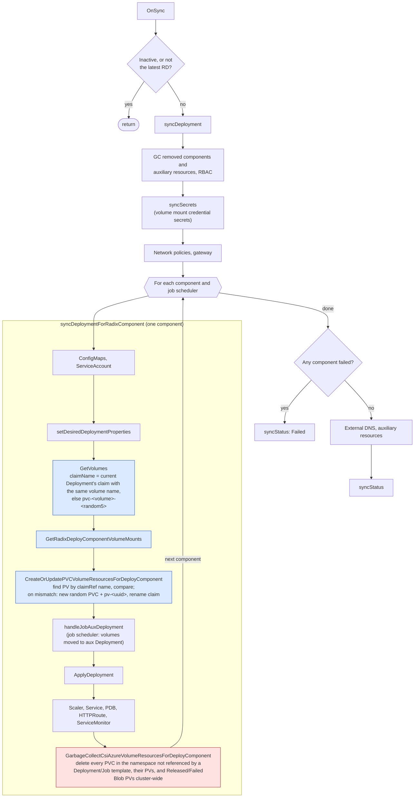
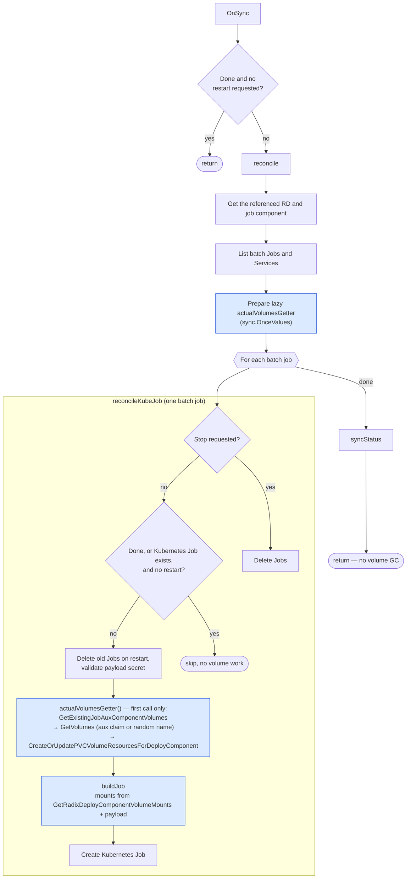
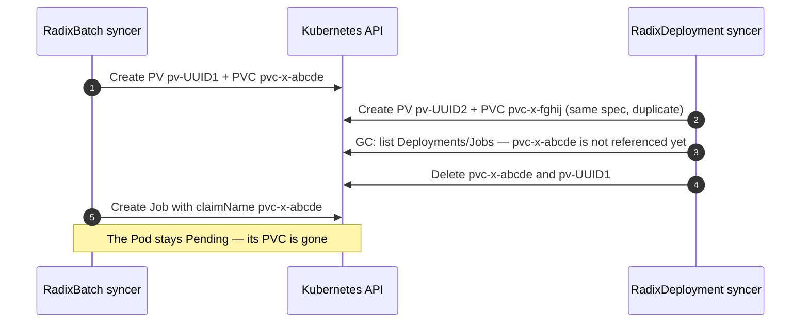

# volumemount: how it used to work

This document describes how volume storage was handled before the rewrite of the `volumemount` package. It is kept for historical reference only. See [README.md](./README.md) for how it works now.

## Overview

Storage was handled by `GetVolumes`, `CreateOrUpdatePVCVolumeResourcesForDeployComponent` (in `pvcvolume.go`) and `GarbageCollectCsiAzureVolumeResourcesForDeployComponent`.

1. **Two-pass volume build.** `GetVolumes` built the Pod volumes and copied the volume source of any current workload volume with the same name. Otherwise it generated a new claim name, `pvc-<volumeName>-<random5>`. Then `CreateOrUpdatePVCVolumeResourcesForDeployComponent` went through those volumes and tried to reconcile the storage behind each claim name.
2. **Name-driven reconciliation with random names.** The reconciler:
   - looked up the PV whose `claimRef.name` matched the claim name, and compared it with a freshly built PV (`ComparePersistentVolumes`, which allowed the random suffix of the claim name to differ);
   - if that PV did not exist, scanned all CSI PVs in the namespace for one with matching labels and spec;
   - checked the PVC with `ComparePersistentVolumeClaims`.

   If anything differed, it created a new PVC with a new random suffix and a new PV named `pv-radixvolumemount-<uuid>`, with a UUID in the volumeHandle. A "HACK" forced the PV to be recreated when it had a storage class but its PVC was missing.
3. **Deprecated volume type.** `type: azure-blob` (with the top-level `storage`, `uid`, `gid`, `accessMode`, `requestsStorage` fields) had its own PV spec builder.
4. **Garbage collection per component.** GC ran inside `syncDeploymentForRadixComponent`, once for every component, before the other components were synced. It:
   - listed all Deployments and Jobs in the namespace and collected the claim names in their Pod templates;
   - deleted **every** PVC in the namespace that was not referenced, with no label filter, together with the PV named in `volumeName`;
   - deleted every CSI PV whose `claimRef.namespace` was this namespace and whose claim was not referenced, in any phase;
   - deleted `Released`/`Failed` Blob CSI PVs **cluster-wide** whose `claimRef.name` was not in this namespace's referenced set.

   Deletes had no preconditions. Volumes for RadixBatches were not considered, except through Jobs that already existed. Nothing cleaned up PVs when an environment was deleted.

## What the rewrite changed

- **Safer deletes.** Only Radix-labelled objects for the app, namespace and component are deleted, while the old cluster-wide PV sweep could delete PVs that belonged to other namespaces. Deletes got `uid` preconditions.
- **Removal of the deprecated `type` volume mount.** The `type`, `storage`, `uid`, `gid`, `accessMode`, `requestsStorage` and `container` fields were removed from the CRD schemas, together with the `azure-blob` PV builder. [#2035](https://github.com/equinor/radix-operator/issues/2035) confirmed that no RadixApplication or RadixDeployment in any cluster used `type: azure-blob`, so no existing volume mount was affected.
- **No extra configuration or RBAC** was needed for the rewrite.

| Step                                  | Before                                                                                                              | After                                                                                     |
| ------------------------------------- | ------------------------------------------------------------------------------------------------------------------- | ----------------------------------------------------------------------------------------- |
| Build Pod volumes                     | `GetVolumes`: reuse the claim name of the current workload's volume with the same name, else generate a random name | `ReconcileComponentVolumes` / `EnsureComponentVolumes`: claim chosen by matching the spec |
| Build container mounts                | Separately, with `GetRadixDeployComponentVolumeMounts` (deployment and batch)                                       | Returned together with the volumes                                                        |
| Create PV/PVC                         | `CreateOrUpdatePVCVolumeResourcesForDeployComponent`, a second pass that could rename claims                        | In the same call, only when no current PV/PVC matches the spec, with new unique names     |
| Delete PV/PVC in RadixDeployment sync | `GarbageCollectCsiAzureVolumeResourcesForDeployComponent` at the end of **every** component's sync, namespace-wide  | Per component, plus garbage collection of removed components and jobs                     |

## RadixDeployment sync: before

Problems in this loop:

- **GC ran N times per sync** (once per component), in the middle of the loop. Later components had not yet created their new PVCs or applied their Deployments.
- **The claim was chosen in two places.** `GetVolumes` picked a name, then `CreateOrUpdatePVCVolumeResourcesForDeployComponent` could replace it with a new random name.
- **GC only knew about Deployments and Jobs that already existed.** It ignored RadixBatches, Pods and specs, so a PVC that was just created for a batch could be deleted.

## RadixBatch sync: before

## How the two controllers interacted

The controllers created pairs with random names on their own, and the RadixDeployment GC could delete a pair the batch syncer had just created.

