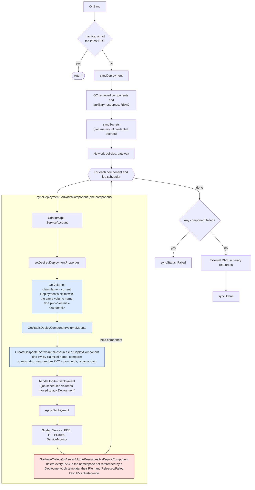
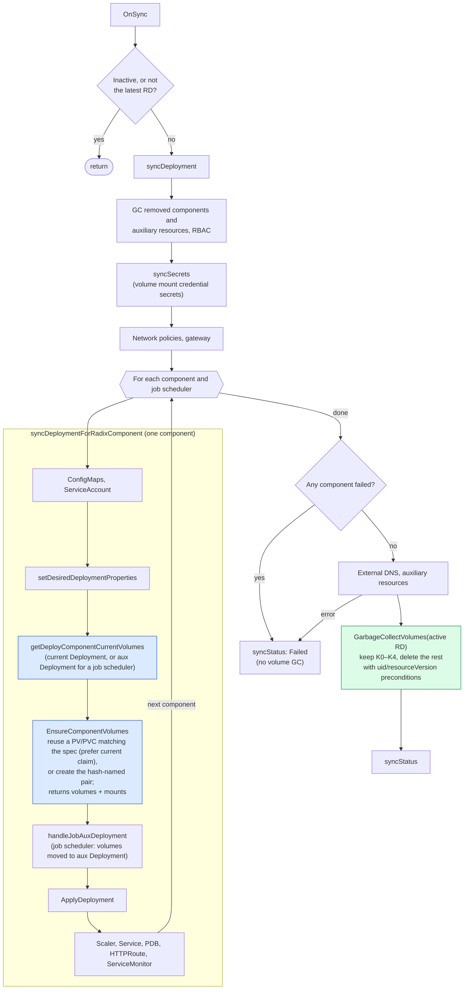
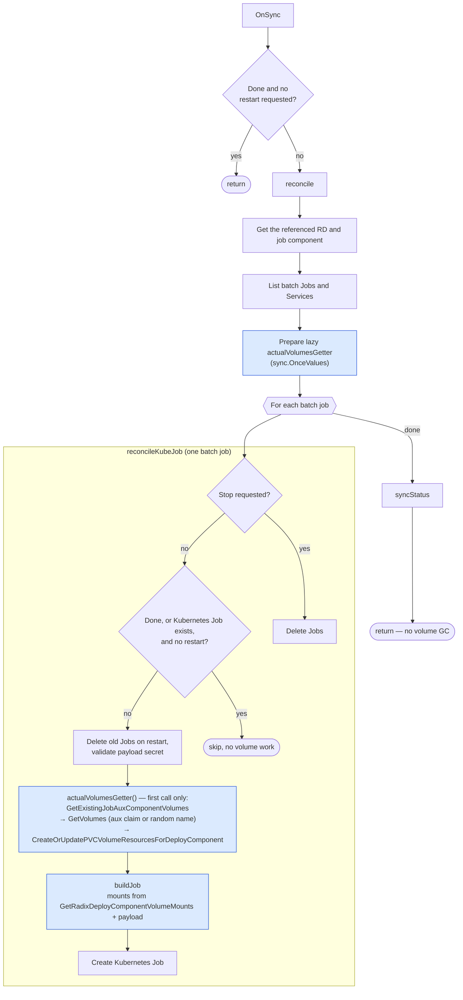
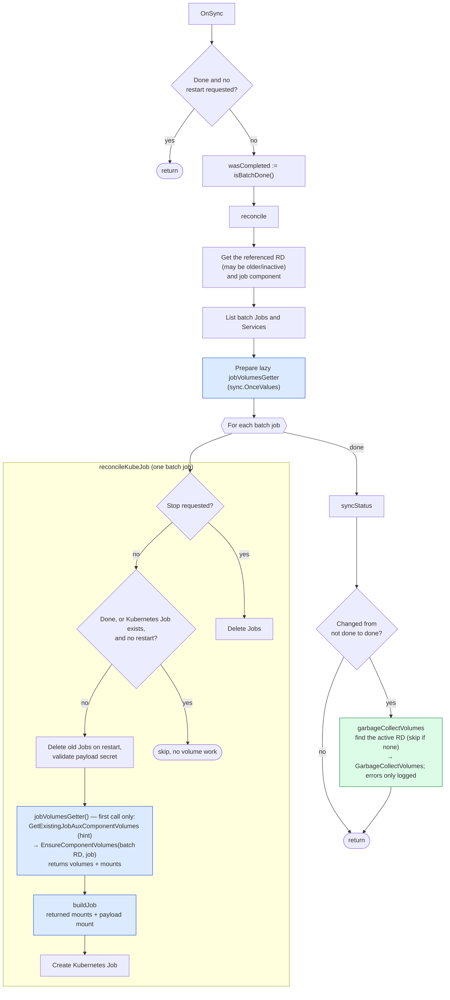
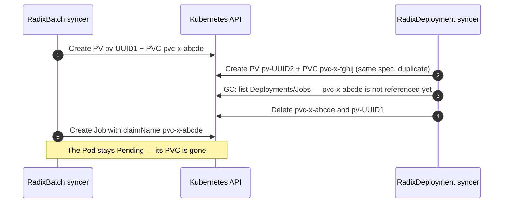
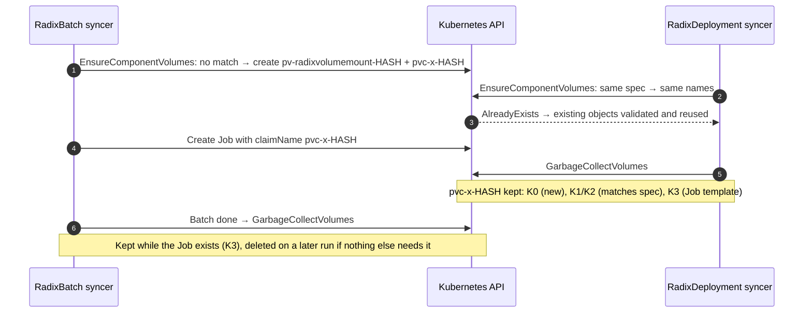

# volumemount

The `volumemount` package turns the `volumeMounts` of a Radix component or job into Pod volumes, container volume mounts, and the Kubernetes storage objects they need. It also cleans up storage objects that are no longer needed.

Supported volume mount types:

| Type        | Pod volume source       | Storage objects                                                                       |
| ----------- | ----------------------- | ------------------------------------------------------------------------------------- |
| `blobFuse2` | `persistentVolumeClaim` | One static PersistentVolume (PV) and one PersistentVolumeClaim (PVC), Blob CSI driver |
| `emptyDir`  | `emptyDir`              | None                                                                                  |

Azure Key Vault `secretRefs` are also mounted as CSI volumes through this package (`getComponentSecretRefsVolumes`).

## Files

| File                                                       | Purpose                                                                                      |
| ---------------------------------------------------------- | -------------------------------------------------------------------------------------------- |
| [ensure.go](./ensure.go)                                   | `EnsureComponentVolumes`: find or create the PV/PVC for each volume mount, build Pod volumes |
| [desired.go](./desired.go)                                 | Build the desired PV/PVC for a volume mount, and the hash used for their names               |
| [match.go](./match.go)                                     | Decide whether an existing PV/PVC pair matches the desired PV/PVC                            |
| [gc.go](./gc.go)                                           | `GarbageCollectVolumes` and `DeletePersistentVolumesForDeletedNamespace`                     |
| [persistentvolumebuilder.go](./persistentvolumebuilder.go) | BlobFuse2 PV spec: CSI attributes and mount options (cache modes and so on)                  |
| [volumemount.go](./volumemount.go)                         | Container volume mounts, volume names, Key Vault volumes, credential secrets                 |

## How it works

### 1. Ensure storage (`EnsureComponentVolumes`)

Two callers use this function:

- `pkg/apis/deployment`, when it builds the Kubernetes Deployment of a component or a job scheduler. The current Deployment's volumes are passed as `currentVolumes`.
- `pkg/apis/batch`, at most once per reconcile, and only when it is about to create a Kubernetes Job. The job-aux Deployment's volumes are passed as `currentVolumes`. The batch uses the RadixDeployment it references, which can be an older, inactive one.

For each BlobFuse2 volume mount the function:

1. Builds the desired PV and PVC (`buildDesiredVolumeResources`). Names come from a SHA-256 hash of a canonical JSON encoding of the namespace, labels, and specs:
   - PV: `pv-radixvolumemount-<hash[:20]>`
   - PVC: `pvc-<volumeName>-<hash[:10]>`
   - CSI `volumeHandle`: `radixvolumemount#<app>#<env>#<component>#<volumeMount>#<hash[:20]>`

   The hash leaves out fields that depend on names or random values: the claimRef name/uid/resourceVersion, the volumeHandle, and the value of `--block-cache-path`. Lists are sorted, so the same spec always gives the same names.
2. Lists the component's PVCs once (label selector `radix-app` + `radix-component`) and groups them by the `radix-volume-mount-name` label.
3. Picks the candidate PVCs that match the desired spec. A candidate must:
   - not be terminating or `Lost`;
   - be bound to an existing PV that is not terminating;
   - be bound both ways (`pvc.spec.volumeName` and `pv.spec.claimRef`);
   - pass `matchesDesired`. This compares the PVC labels, resources, access modes, volume mode and storage class. It also compares four PV labels, plus PV capacity, access modes, normalized mount options, CSI driver, node-stage secret, CSI attributes (without provisioner-set keys), reclaim policy and storage class.
4. If a matching PV still has the uid of a deleted PVC with the same name in its claimRef, it clears `claimRef.uid` and `claimRef.resourceVersion`, so the recreated PVC can bind. This is the only update the function makes.
5. If there are several matches, it picks one in this order:
   1. a claim used by the current workload (`currentVolumes`), so running Pods keep their claim;
   2. the claim with the hash-based name;
   3. the oldest claim (then by name).
6. If nothing matches, it creates the PV and then the PVC. Names come from the spec, so another controller (for example the batch syncer) may have created the same objects already. On `AlreadyExists` the existing object is validated and used. It must not be terminating, must match the spec, and must be bound to its counterpart. A conflict returns an error, and the existing object is never updated or deleted.

`EnsureComponentVolumes` never deletes anything. Matching uses the spec, not the name. Existing PVCs with older naming schemes (random suffix, UUID PV names) are therefore reused as long as their spec and labels still match.

### 2. Garbage collection (`GarbageCollectVolumes`)

It deletes Radix-owned PVCs, and their PVs, in the namespace of the active RadixDeployment. Radix-owned means:

- PVCs with `radix-app=<app>` and a `radix-volume-mount-name` label;
- PVs with `radix-app=<app>`, `radix-namespace=<ns>` and a `radix-volume-mount-name` label.

It runs:

- at the end of `syncDeployment` for the active RadixDeployment, and only if everything else synced. Workloads that failed to sync keep their volumes;
- once, when a RadixBatch changes to done. It uses the namespace's active RadixDeployment. Errors are logged and do not fail the batch sync.

It reads everything it needs before it deletes anything, and any read error stops the run. A PVC is **kept** if any of these apply:

| Rule | Keep the PVC when…                                                                                                                                        |
| ---- | --------------------------------------------------------------------------------------------------------------------------------------------------------- |
| K0   | it is younger than `volumeGarbageCollectionGracePeriod` (default `10m`). This covers stale caches and in-flight creates by other controllers              |
| K1   | it matches the desired spec of a component or job in the active RadixDeployment                                                                           |
| K2   | it matches the desired spec of the job of an unfinished RadixBatch (not Completed, or a restart is pending), in the RadixDeployment that batch references |
| K3   | the Pod template of an existing Job or Deployment, or of a ReplicaSet with replicas > 0, references it                                                    |
| K4   | a Pod that is not `Succeeded` or `Failed` mounts it                                                                                                       |

PVCs that are not kept are deleted, and then their bound PV is deleted if it is Radix-owned and its claimRef points back to the PVC. After that, Radix-owned PVs in phase `Released`, `Failed` or `Available` are deleted. They are skipped if they are within the grace period or their claimRef points to a kept PVC.

Every delete sends `uid` and `resourceVersion` preconditions. If an object changed after it was evaluated, the delete returns `Conflict` and is skipped. It is evaluated again on the next run.

All PVs use `persistentVolumeReclaimPolicy: Retain`, so **blob data is never deleted**. Only the Kubernetes objects are removed.

### 3. Deleted environments (`DeletePersistentVolumesForDeletedNamespace`)

PVs are cluster-scoped and are not deleted with a namespace. The environment controller now queues an item when a RadixEnvironment or an environment namespace is deleted. If the RadixEnvironment no longer exists, the handler deletes the Radix-owned PVs labelled for that namespace, but only once the namespace is terminating or gone.

### Configuration and RBAC

- `config.operator.volumeGarbageCollectionGracePeriod` (Helm `values.yaml`, default `10m`).
- The operator needs `get`/`list` on `apps/replicasets` (rule K3).

## How it used to work

Before this change, storage was handled by `GetVolumes`, `CreateOrUpdatePVCVolumeResourcesForDeployComponent` (in `pvcvolume.go`) and `GarbageCollectCsiAzureVolumeResourcesForDeployComponent`.

1. **Two-pass volume build.** `GetVolumes` built the Pod volumes and copied the volume source of any current workload volume with the same name. Otherwise it generated a new claim name, `pvc-<volumeName>-<random5>`. Then `CreateOrUpdatePVCVolumeResourcesForDeployComponent` went through those volumes and tried to reconcile the storage behind each claim name.
2. **Name-driven reconciliation with random names.** The reconciler:
   - looked up the PV whose `claimRef.name` matched the claim name, and compared it with a freshly built PV (`ComparePersistentVolumes`, which allowed the random suffix of the claim name to differ);
   - if that PV did not exist, scanned all CSI PVs in the namespace for one with matching labels and spec;
   - checked the PVC with `ComparePersistentVolumeClaims`.

   If anything differed, it created a new PVC with a new random suffix and a new PV named `pv-radixvolumemount-<uuid>`, with a UUID in the volumeHandle. A "HACK" forced the PV to be recreated when it had a storage class but its PVC was missing.
3. **Deprecated volume type.** `type: azure-blob` (with the top-level `storage`, `uid`, `gid`, `accessMode`, `requestsStorage` fields) had its own PV spec builder.
4. **Garbage collection per component.** GC ran inside `syncDeploymentForRadixComponent`, once for every component, before the other components were synced. It:
   - listed all Deployments and Jobs in the namespace and collected the claim names in their Pod templates;
   - deleted **every** PVC in the namespace that was not referenced, with no label filter, together with the PV named in `volumeName`;
   - deleted every CSI PV whose `claimRef.namespace` was this namespace and whose claim was not referenced, in any phase;
   - deleted `Released`/`Failed` Blob CSI PVs **cluster-wide** whose `claimRef.name` was not in this namespace's referenced set.

   Deletes had no preconditions. Volumes for RadixBatches were not considered, except through Jobs that already existed. Nothing cleaned up PVs when an environment was deleted.

## Pros and cons of the change

### Pros

- **Deterministic, idempotent naming.** The same spec always gives the same PV/PVC names. Concurrent creates from the deployment and batch syncers converge on one pair through `AlreadyExists` handling, so duplicate PV/PVC pairs are no longer created.
- **Spec-based reuse.** Unchanged volume mounts keep their claim even if other parts of the component change. After an upgrade, existing PVCs with legacy random names are reused when they match, so workloads are not restarted.
- **Single pass, clear separation.** Ensuring storage only creates objects (plus the claimRef-uid fix), and garbage collection only deletes them. Each is simple to reason about and to test.
- **Much safer garbage collection:**
  - it only touches Radix-labelled objects for the current app and namespace, while the old cluster-wide PV sweep could delete PVs that belonged to other namespaces;
  - it runs once, after everything else has synced successfully, not once per component in the middle of the sync;
  - the grace period (K0) and unfinished-batch rule (K2) close the race where a PVC the batch syncer had just created was deleted before its Job existed;
  - running Pods (K4) and scaled-down workloads (K3) are protected;
  - delete preconditions prevent deleting an object that was changed or recreated after it was evaluated;
  - a read error stops the run before anything is deleted.
- **Fixes the stale claimRef problem.** A PVC recreated with the same name can bind to its Retained PV again.
- **No more leaked PVs on environment deletion.**
- **Less code.** The deprecated `azure-blob` volume type and its builder are gone, and the PV/PVC logic is split into small files with focused tests.

### Cons / risks

- **Breaking removal of the deprecated `type` volume mount.** The `type`, `storage`, `uid`, `gid`, `accessMode`, `requestsStorage` and `container` fields are removed from the CRD schemas. Kubernetes drops unknown fields from stored objects. An existing RadixApplication or RadixDeployment that still uses `type: azure-blob` then has a volume mount with no type, so validation fails and the RadixDeployment sync fails with `missing configuration for volumeMount`. [#2035](https://github.com/equinor/radix-operator/issues/2035) records that every RadixDeployment already uses BlobFuse2, but any new usage before rollout would break.
- **Objects without labels are never cleaned up.** GC only selects objects with Radix labels, and matching requires the PV labels. [#2035](https://github.com/equinor/radix-operator/issues/2035) §6 confirms that all Radix PVs/PVCs in the current clusters are labelled. Any object without labels would not match: a new pair would be created, and the old one would stay until removed by hand. The old GC deleted every unreferenced PVC, labelled or not.
- **More API calls per sync.** For each component, ensuring storage does one PVC list plus one PV `Get` per candidate. Each GC run lists PVCs, PVs, Jobs, Deployments, ReplicaSets, Pods and RadixBatches in the namespace, using the API directly and not informer caches. The run returns early when the namespace has no Radix PVCs/PVs.
- **Storage is kept longer.** Completed Jobs still in history (K3), and objects inside the grace period, keep their PVC/PV. Cleanup is therefore delayed until Jobs are pruned, or until the next RadixDeployment sync after the grace period. RadixBatch completion triggers GC only once, so an object still in its grace period at that point waits for a later RadixDeployment sync.
- **The hash depends on how specs are encoded.** Changes to Kubernetes API types, default mount options or labels change the hash. This is not disruptive, because matching uses the spec, not the name. But a semantic change to the generated spec (for example a new default mount option) still causes a new PV/PVC and a Pod restart for every affected volume mount, as before.
- **Possible error loops.** A conflicting object at the hash name, for example one that is terminating or bound elsewhere, makes ensuring storage fail until it is gone. This is intentional, but the sync keeps failing during that time.
- **`GarbageCollectVolumes` in the deployment syncer uses `time.Now()` directly** (the batch syncer uses an injected clock), which makes the grace-period behaviour harder to test from that caller.

## Appendix: where volume logic runs in the reconciliation loops

Volume logic is triggered from two controllers: the RadixDeployment syncer (`pkg/apis/deployment`) and the RadixBatch syncer (`pkg/apis/batch`). The operator runs with `resyncPeriod = 0`, so both only run when their resource, or a resource they watch, changes. The environment controller only handles PVs of deleted namespaces (see [section 3](#3-deleted-environments-deletepersistentvolumesfordeletednamespace)).

### Summary

| Step                              | Before                                                                                                              | Now                                                                                                 |
| --------------------------------- | ------------------------------------------------------------------------------------------------------------------- | --------------------------------------------------------------------------------------------------- |
| Build Pod volumes                 | `GetVolumes`: reuse the claim name of the current workload's volume with the same name, else generate a random name | `EnsureComponentVolumes`: claim chosen by matching the spec of existing PV/PVC pairs                |
| Build container mounts            | Separately, with `GetRadixDeployComponentVolumeMounts` (deployment and batch)                                       | Returned together with the volumes by `EnsureComponentVolumes`                                      |
| Create PV/PVC                     | `CreateOrUpdatePVCVolumeResourcesForDeployComponent`, a second pass that could rename claims                        | Inside `EnsureComponentVolumes`, names derived from the spec hash                                   |
| GC in RadixDeployment sync        | `GarbageCollectCsiAzureVolumeResourcesForDeployComponent` at the end of **every** component's sync                  | `GarbageCollectVolumes` **once**, at the end of `syncDeployment`, only if everything else succeeded |
| GC in RadixBatch sync             | None                                                                                                                | `GarbageCollectVolumes` once, when the batch changes to done (errors are only logged)               |
| GC when an environment is deleted | None                                                                                                                | `DeletePersistentVolumesForDeletedNamespace` from the environment controller                        |

In the diagrams below, steps that touch volume storage are highlighted.

### RadixDeployment sync: before

Problems in this loop:

- **GC ran N times per sync** (once per component), in the middle of the loop. Later components had not yet created their new PVCs or applied their Deployments.
- **The claim was chosen in two places.** `GetVolumes` picked a name, then `CreateOrUpdatePVCVolumeResourcesForDeployComponent` could replace it with a new random name.
- **GC only knew about Deployments and Jobs that already existed.** It ignored RadixBatches, Pods and specs, so a PVC that was just created for a batch could be deleted.

### RadixDeployment sync: now

What changed:

- **The per-component loop only creates.** `EnsureComponentVolumes` never deletes, so components can't interfere with each other within a sync.
- **GC runs once, after every Deployment has been applied**, and is skipped if anything failed. A failed workload keeps its current claims. These are also protected by K3, because its Deployment template still references them.
- **Volumes and mounts come from one call**, so they can't get out of sync.

### RadixBatch sync: before

### RadixBatch sync: now

What changed:

- **Storage is ensured from the batch's own RD**, which can be an older, inactive one, using the same matching and hash naming as the RadixDeployment syncer. Both controllers therefore reuse or create the same PV/PVC.
- **Job mounts come from `EnsureComponentVolumes`**, not from a separate call.
- **The batch triggers GC once, when it finishes**, so storage used only by that batch is released without waiting for the next RadixDeployment sync. While the batch is unfinished, its storage is protected by K2.

### How the two controllers interact

Before: the controllers created pairs with random names on their own, and the RadixDeployment GC could delete a pair the batch syncer had just created.

Now: both controllers compute the same names from the spec, and GC keeps anything new, desired or in use.

