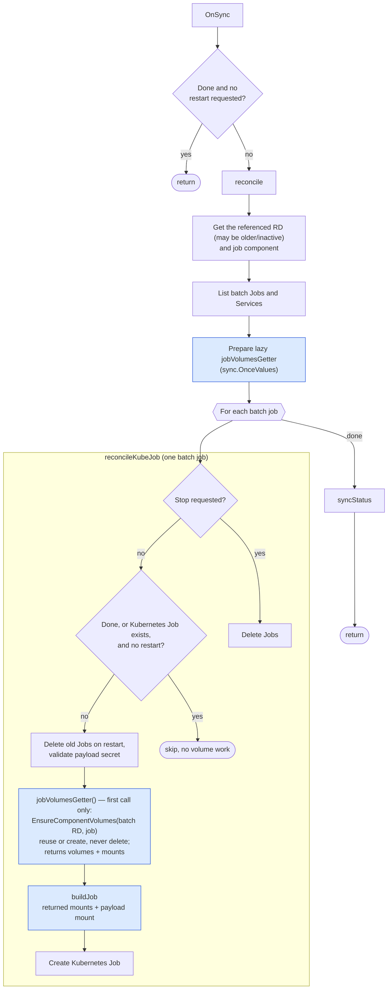
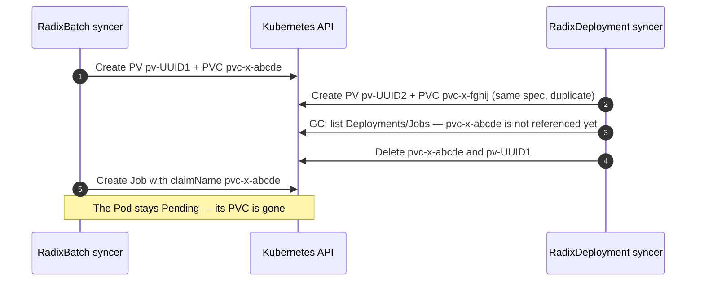
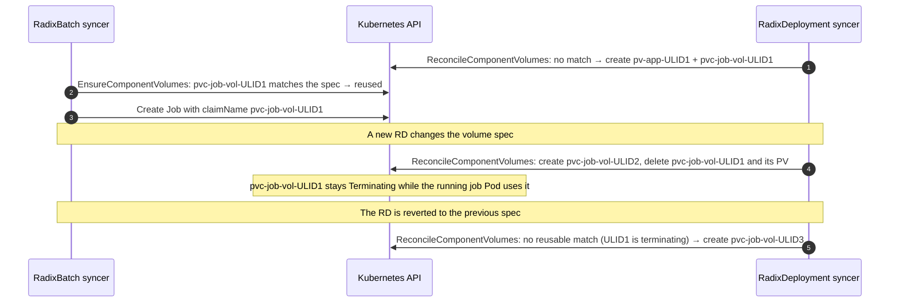

# volumemount

The `volumemount` package turns the `volumeMounts` of a Radix component or job into Pod volumes, container volume mounts, and the Kubernetes storage objects they need. It also cleans up storage objects that are no longer needed.

Supported volume mount types:

| Type        | Pod volume source       | Storage objects                                                                       |
| ----------- | ----------------------- | ------------------------------------------------------------------------------------- |
| `blobFuse2` | `persistentVolumeClaim` | One static PersistentVolume (PV) and one PersistentVolumeClaim (PVC), Blob CSI driver |
| `emptyDir`  | `emptyDir`              | None                                                                                  |

Azure Key Vault `secretRefs` are also mounted as CSI volumes through this package (`getComponentSecretRefsVolumes`).

## Files

| File                                                       | Purpose                                                                                                                                               |
| ---------------------------------------------------------- | ----------------------------------------------------------------------------------------------------------------------------------------------------- |
| [reconcile.go](./reconcile.go)                             | `ReconcileComponentVolumes` and `EnsureComponentVolumes`: reuse and create PV/PVCs. `componentStorage` holds the arguments of one component reconcile |
| [gc.go](./gc.go)                                           | `GarbageCollectVolumesNoLongerInSpec` and deletion of unused PV/PVCs, with the deletion grace period                                                  |
| [desired.go](./desired.go)                                 | Build the desired PV/PVC for a volume mount, with new unique names                                                                                    |
| [match.go](./match.go)                                     | Decide whether an existing PV/PVC pair matches the desired PV/PVC                                                                                     |
| [persistentvolumebuilder.go](./persistentvolumebuilder.go) | BlobFuse2 PV spec: CSI attributes and mount options (cache modes and so on)                                                                           |
| [volumemount.go](./volumemount.go)                         | Container volume mounts, volume names, Key Vault volumes, credential secrets                                                                          |

## How it works

There are three entry points, in [reconcile.go](./reconcile.go) and [gc.go](./gc.go):

| Function                              | Caller                                                                      | Creates | Deletes                                           |
| ------------------------------------- | --------------------------------------------------------------------------- | ------- | ------------------------------------------------- |
| `ReconcileComponentVolumes`           | RadixDeployment sync, for each component and job scheduler                  | yes     | every other PV/PVC of the component               |
| `EnsureComponentVolumes`              | RadixBatch sync, once per reconcile, when a Kubernetes Job will be created  | yes     | never                                             |
| `GarbageCollectVolumesNoLongerInSpec` | RadixDeployment sync, with the other "no longer in spec" garbage collectors | no      | every PV/PVC of components and jobs not in the RD |

The design relies on Kubernetes storage object protection: a PVC that is used by a Pod (`kubernetes.io/pvc-protection`), and a PV that is bound to a PVC (`kubernetes.io/pv-protection`), stay `Terminating` until they are no longer used. A running workload therefore keeps working with its current PV/PVC, even after the operator has deleted them. All PVs use `persistentVolumeReclaimPolicy: Retain`, so **blob data is never deleted**. Only the Kubernetes objects are removed.

### Find or create the PV/PVC of a volume mount

`ReconcileComponentVolumes` and `EnsureComponentVolumes` share the same logic:

1. The caller passes in the application name (the RadixRegistration name). The deprecated `spec.appName` of the RadixDeployment is not used.
2. The current PVCs of the component are listed once (label selector `radix-app` + `radix-component`, with a `radix-volume-mount-name` label) and grouped by the `radix-volume-mount-name` label.
3. For each BlobFuse2 volume mount, a current PVC is reused if it matches the desired spec (`buildDesiredVolumeResources`). It must:
   - not be terminating or `Lost`;
   - be bound to an existing PV that is not terminating;
   - be bound both ways (`pvc.spec.volumeName` and `pv.spec.claimRef`), and the PV `claimRef.uid` must be empty or the uid of the PVC. A PV with the uid of a deleted PVC with the same name never binds to the PVC, so such a pair is not reused;
   - pass `matchesDesired`. This compares the PVC labels, resources, access modes, volume mode and storage class. It also compares four PV labels, plus PV capacity, access modes, normalized mount options, CSI driver, node-stage secret, CSI attributes (without provisioner-set keys), reclaim policy and storage class. Names, the volume handle and the `--block-cache-path` value are not compared.

   If several PVCs match, a PVC that is used by the Pod template of the current Kubernetes Deployment of the component (the job-aux Deployment for a job) is preferred, so an unchanged spec never rolls out the workload, e.g. when several legacy pairs match and the Deployment uses one that is not the oldest. Otherwise, or if several of them are used, the oldest is used (then by name).
4. If nothing matches, the desired PV and then the PVC are created. Each build of the desired PV/PVC gets a new [ULID](https://github.com/oklog/ulid) as unique part of the names:
   - PV: `pv-<app>-<ulid>`
   - PVC: `pvc-<component>-<volumeMount>-<ulid>`
   - CSI `volumeHandle`: `radixvolumemount#<app>#<env>#<component>#<volumeMount>#<ulid>`, which is also used in the `--block-cache-path` mount option

   New names never conflict with existing objects, e.g. a pair for the same spec that is still terminating after a revert of the spec. If the PVC cannot be created, the PV is left behind, and deleted when the component is reconciled after the [deletion grace period](#deletion-grace-period).

Matching uses the spec, not the name. Existing PVCs with older naming schemes (random suffix, UUID PV names) are therefore reused as long as their spec and labels still match.

### RadixDeployment sync (`ReconcileComponentVolumes`)

After the PV/PVC of every volume mount has been found or created, every other PVC and PV of the component is deleted: PVCs and PVs for an older spec, for removed volume mounts, duplicates, and `Released` PVs. Radix-owned means:

- PVCs with `radix-app=<app>`, `radix-component=<component>` and a `radix-volume-mount-name` label;
- PVs with `radix-app=<app>`, `radix-namespace=<ns>`, `radix-component=<component>` and a `radix-volume-mount-name` label.

PVCs are deleted before PVs. Objects that are already terminating, or that were created less than the [deletion grace period](#deletion-grace-period) ago, are skipped. Deletes have a `uid` precondition, so an object recreated with the same name is not deleted. If finding or creating the PV/PVC of any volume mount fails, nothing is deleted.

For a job, the volumes are reconciled for the `RadixDeployJobComponent` itself, the same object the RadixBatch syncer uses, so both syncers find or create the same PV/PVC. The volumes and mounts are set on the job-aux Deployment, and the job scheduler Deployment gets none. The job-aux container mounts the job volumes as a canary: if a volume cannot be mounted, users are warned before a job runs. PV/PVCs that RadixBatches created from another job spec are deleted too. A job that is running keeps its PV/PVC until it completes.

### RadixBatch sync (`EnsureComponentVolumes`)

The batch syncer uses the RadixDeployment the batch references, which can be an older, inactive one, so its jobs get the storage defined in it. It never deletes anything. PV/PVCs that are no longer needed are deleted the next time the active RadixDeployment syncs.

### Components and jobs removed from the RadixDeployment (`GarbageCollectVolumesNoLongerInSpec`)

Runs in `garbageCollectComponentsNoLongerInSpec` at the start of the RadixDeployment sync, like the garbage collection of other resources. It deletes all Radix-owned PVCs and PVs in the namespace (same labels as above, without the component label) whose `radix-component` label is not a component or job in the RadixDeployment. The [deletion grace period](#deletion-grace-period) applies here too.

### Deletion grace period

PVCs and PVs created less than the deletion grace period ago are never deleted, by `ReconcileComponentVolumes` or by `GarbageCollectVolumesNoLongerInSpec`. The RadixDeployment and RadixBatch syncers do not share a lock, so the batch syncer can create a pair for a job while the RadixDeployment syncer cleans up the storage of that job, for example when both find no matching pair and each creates its own. Without the grace period, the batch's new pair could be deleted before the Pod of its Kubernetes Job exists. Once that Pod exists (even `Pending`), storage object protection keeps the pair.

The grace period is set by `operator.volumeDeletionGracePeriod` in the operator config (`config.operator.volumeDeletionGracePeriod` in the Helm chart, default `10m`, minimum `1s`). It is passed to `ReconcileComponentVolumes` and `GarbageCollectVolumesNoLongerInSpec`. The e2e tests use a few seconds, and trigger RadixDeployment syncs until the unused objects are gone.

Objects that are skipped are deleted the next time the RadixDeployment syncs after the grace period. The operator has no periodic resync, so this can take a while: the next sync of the RadixDeployment, e.g. a new deployment.

### Deleted environments

Nothing is done when an environment namespace is deleted. The PVCs are deleted with the namespace, and their PVs become `Released` and are kept, as PVs are cluster scoped.

## How it used to work

Before this change, storage was handled by `GetVolumes`, `CreateOrUpdatePVCVolumeResourcesForDeployComponent` (in `pvcvolume.go`) and `GarbageCollectCsiAzureVolumeResourcesForDeployComponent`.

1. **Two-pass volume build.** `GetVolumes` built the Pod volumes and copied the volume source of any current workload volume with the same name. Otherwise it generated a new claim name, `pvc-<volumeName>-<random5>`. Then `CreateOrUpdatePVCVolumeResourcesForDeployComponent` went through those volumes and tried to reconcile the storage behind each claim name.
2. **Name-driven reconciliation with random names.** The reconciler:
   - looked up the PV whose `claimRef.name` matched the claim name, and compared it with a freshly built PV (`ComparePersistentVolumes`, which allowed the random suffix of the claim name to differ);
   - if that PV did not exist, scanned all CSI PVs in the namespace for one with matching labels and spec;
   - checked the PVC with `ComparePersistentVolumeClaims`.

   If anything differed, it created a new PVC with a new random suffix and a new PV named `pv-radixvolumemount-<uuid>`, with a UUID in the volumeHandle. A "HACK" forced the PV to be recreated when it had a storage class but its PVC was missing.
3. **Deprecated volume type.** `type: azure-blob` (with the top-level `storage`, `uid`, `gid`, `accessMode`, `requestsStorage` fields) had its own PV spec builder.
4. **Garbage collection per component.** GC ran inside `syncDeploymentForRadixComponent`, once for every component, before the other components were synced. It:
   - listed all Deployments and Jobs in the namespace and collected the claim names in their Pod templates;
   - deleted **every** PVC in the namespace that was not referenced, with no label filter, together with the PV named in `volumeName`;
   - deleted every CSI PV whose `claimRef.namespace` was this namespace and whose claim was not referenced, in any phase;
   - deleted `Released`/`Failed` Blob CSI PVs **cluster-wide** whose `claimRef.name` was not in this namespace's referenced set.

   Deletes had no preconditions. Volumes for RadixBatches were not considered, except through Jobs that already existed. Nothing cleaned up PVs when an environment was deleted.

## Pros and cons of the change

### Pros

- **Simple model.** For each component the operator keeps exactly the PV/PVC the spec needs and deletes the rest. There is no separate garbage collection with keep rules or cross-resource scans, only a configurable grace period for new objects. Kubernetes storage object protection keeps PV/PVCs that are still used by Pods.
- **Unique names.** A new PV/PVC never conflicts with an existing object, so reverting a spec while the pair for it is still terminating creates a new pair at once, instead of failing until the old pair is gone.
- **Spec-based reuse.** Unchanged volume mounts keep their claim even if other parts of the component change. After an upgrade, existing PVCs with legacy random names are reused when they match, so workloads are not restarted.
- **Safer deletes than before.** Only Radix-labelled objects for the app, namespace and component are deleted, while the old cluster-wide PV sweep could delete PVs that belonged to other namespaces. Deletes have `uid` preconditions, and nothing is deleted for a component whose storage could not be ensured.
- **No stale claimRef problem.** A pair whose PV refers to a deleted PVC with the same name is not reused, and is deleted when the component is reconciled.
- **Less code.** The deprecated `azure-blob` volume type and its builder are gone, and no extra configuration or RBAC is needed.

### Cons / risks

- **Removal of the deprecated `type` volume mount.** The `type`, `storage`, `uid`, `gid`, `accessMode`, `requestsStorage` and `container` fields are removed from the CRD schemas. [#2035](https://github.com/equinor/radix-operator/issues/2035) confirms that no RadixApplication or RadixDeployment in any cluster uses `type: azure-blob`, so no existing volume mount is affected.
- **Pods that are not yet running cannot use a deleted PVC.** Kubernetes does not schedule a Pod whose PVC is terminating. A RadixBatch for an older RadixDeployment with another volume spec gets its own PV/PVC, which is deleted when the active RadixDeployment syncs after the deletion grace period. A job Pod of that batch that is created after the pair was deleted (or a Pod of an old ReplicaSet that is recreated during a rollout) then stays `Pending`.
- **Released PVs of deleted environments are not cleaned up.** PVs are cluster scoped and are not deleted with the namespace.
- **Objects without labels are never cleaned up.** Only objects with Radix labels are selected, and matching requires the PV labels. [#2035](https://github.com/equinor/radix-operator/issues/2035) §6 confirms that all Radix PVs/PVCs in the current clusters are labelled. Any object without labels would not match: a new pair would be created, and the old one would stay until removed by hand.
- **Creates are not idempotent.** When the RadixDeployment and RadixBatch syncers find no matching pair for the same spec at the same time, both create a pair. The deletion grace period keeps the extra pair long enough for the Pod of the batch Job to be created, and the first RadixDeployment sync after the grace period deletes whichever pair is unused. Likewise, a PV left behind by a failed PVC create is only deleted by the first RadixDeployment sync after the grace period.
- **A semantic change to the generated spec** (for example a new default mount option) causes a new PV/PVC and a Pod restart for every affected volume mount, as before.

## Appendix: where volume logic runs in the reconciliation loops

Volume logic is triggered from two controllers: the RadixDeployment syncer (`pkg/apis/deployment`) and the RadixBatch syncer (`pkg/apis/batch`). The operator runs with `resyncPeriod = 0`, so both only run when their resource, or a resource they watch, changes.

### Summary

| Step                                  | Before                                                                                                              | Now                                                                                                                                                                         |
| ------------------------------------- | ------------------------------------------------------------------------------------------------------------------- | --------------------------------------------------------------------------------------------------------------------------------------------------------------------------- |
| Build Pod volumes                     | `GetVolumes`: reuse the claim name of the current workload's volume with the same name, else generate a random name | `ReconcileComponentVolumes` / `EnsureComponentVolumes`: claim chosen by matching the spec                                                                                   |
| Build container mounts                | Separately, with `GetRadixDeployComponentVolumeMounts` (deployment and batch)                                       | Returned together with the volumes                                                                                                                                          |
| Create PV/PVC                         | `CreateOrUpdatePVCVolumeResourcesForDeployComponent`, a second pass that could rename claims                        | In the same call, only when no current PV/PVC matches the spec, with new unique (ULID) names                                                                                |
| Delete PV/PVC in RadixDeployment sync | `GarbageCollectCsiAzureVolumeResourcesForDeployComponent` at the end of **every** component's sync, namespace-wide  | `ReconcileComponentVolumes` deletes the unused PV/PVCs of the component it reconciles; `GarbageCollectVolumesNoLongerInSpec` deletes PV/PVCs of removed components and jobs |
| Delete PV/PVC in RadixBatch sync      | None                                                                                                                | None                                                                                                                                                                        |
| Delete PVs of deleted environments    | None                                                                                                                | None                                                                                                                                                                        |

In the diagrams below, steps that touch volume storage are highlighted.

### RadixDeployment sync: before

Problems in this loop:

- **GC ran N times per sync** (once per component), in the middle of the loop. Later components had not yet created their new PVCs or applied their Deployments.
- **The claim was chosen in two places.** `GetVolumes` picked a name, then `CreateOrUpdatePVCVolumeResourcesForDeployComponent` could replace it with a new random name.
- **GC only knew about Deployments and Jobs that already existed.** It ignored RadixBatches, Pods and specs, so a PVC that was just created for a batch could be deleted.

### RadixDeployment sync: now

What changed:

- **Each component owns its storage.** `ReconcileComponentVolumes` only deletes PV/PVCs labelled for the component it reconciles, so components can't interfere with each other.
- **Old storage is deleted upfront.** Kubernetes keeps a PV/PVC that is still mounted by a Pod in `Terminating` state until the Pod is gone, so the rollout to the new PV/PVC is not affected.
- **Removed components and jobs** are cleaned up with the other "no longer in spec" garbage collection.
- **Volumes and mounts come from one call**, so they can't get out of sync.

### RadixBatch sync: before

### RadixBatch sync: now

What changed:

- **Storage is ensured from the batch's own RD**, which can be an older, inactive one, using the same matching as the RadixDeployment syncer. Both controllers therefore reuse the same PV/PVC when it exists.
- **Job mounts come from `EnsureComponentVolumes`**, not from a separate call.
- **The batch syncer never deletes storage.** That is left to the RadixDeployment syncer.

### How the two controllers interact

Before: the controllers created pairs with random names on their own, and the RadixDeployment GC could delete a pair the batch syncer had just created.

Now: both controllers reuse any pair that matches the spec, so they share one pair once it exists. Only a batch for an RD with another volume spec gets its own pair, which the RadixDeployment syncer deletes.

