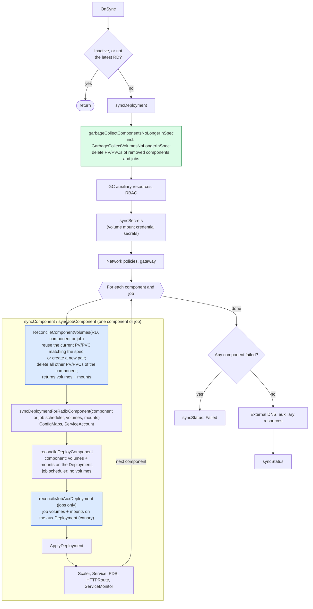
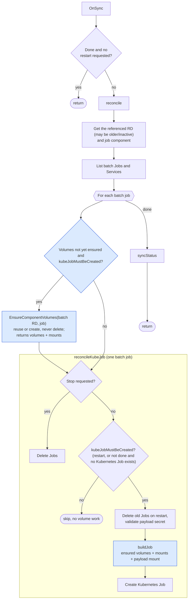
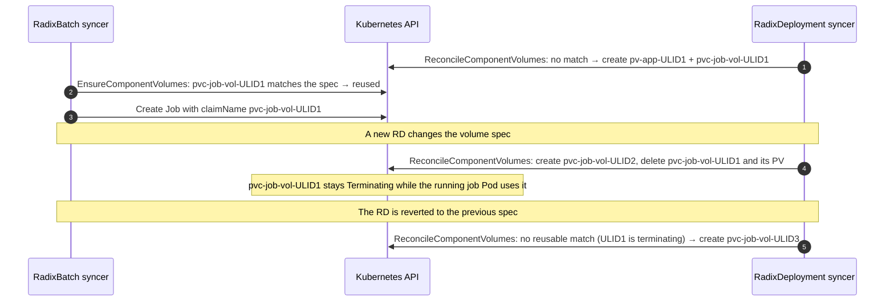

# volumemount

The `volumemount` package turns the `volumeMounts` of a Radix component or job into Pod volumes, container volume mounts, and the Kubernetes storage objects they need. It also cleans up storage objects that are no longer needed.

Supported volume mount types:

| Type        | Pod volume source       | Storage objects                                                                       |
| ----------- | ----------------------- | ------------------------------------------------------------------------------------- |
| `blobFuse2` | `persistentVolumeClaim` | One static PersistentVolume (PV) and one PersistentVolumeClaim (PVC), Blob CSI driver |
| `emptyDir`  | `emptyDir`              | None                                                                                  |

Azure Key Vault `secretRefs` are also mounted as CSI volumes through this package (`getComponentSecretRefsVolumes`).

## Files

| File                                                       | Purpose                                                                                                                                               |
| ---------------------------------------------------------- | ----------------------------------------------------------------------------------------------------------------------------------------------------- |
| [reconcile.go](./reconcile.go)                             | `ReconcileComponentVolumes` and `EnsureComponentVolumes`: reuse and create PV/PVCs. `componentStorage` holds the arguments of one component reconcile |
| [gc.go](./gc.go)                                           | `GarbageCollectVolumesNoLongerInSpec` and deletion of unused PV/PVCs                                                                                  |
| [desired.go](./desired.go)                                 | Build the desired PV/PVC for a volume mount, with new unique names                                                                                    |
| [match.go](./match.go)                                     | Decide whether an existing PV/PVC pair matches the desired PV/PVC                                                                                     |
| [persistentvolumebuilder.go](./persistentvolumebuilder.go) | BlobFuse2 PV spec: CSI attributes and mount options (cache modes and so on)                                                                           |
| [volumemount.go](./volumemount.go)                         | Container volume mounts, volume names, Key Vault volumes, credential secrets                                                                          |

## How it works

There are three entry points, in [reconcile.go](./reconcile.go) and [gc.go](./gc.go):

| Function                              | Caller                                                                      | Creates | Deletes                                           |
| ------------------------------------- | --------------------------------------------------------------------------- | ------- | ------------------------------------------------- |
| `ReconcileComponentVolumes`           | RadixDeployment sync, for each component and job scheduler                  | yes     | every other PV/PVC of the component               |
| `EnsureComponentVolumes`              | RadixBatch sync, once per reconcile, when a Kubernetes Job will be created  | yes     | never                                             |
| `GarbageCollectVolumesNoLongerInSpec` | RadixDeployment sync, with the other "no longer in spec" garbage collectors | no      | every PV/PVC of components and jobs not in the RD |

The design relies on Kubernetes storage object protection: a PVC that is used by a Pod (`kubernetes.io/pvc-protection`), and a PV that is bound to a PVC (`kubernetes.io/pv-protection`), stay `Terminating` until they are no longer used. A running workload therefore keeps working with its current PV/PVC, even after the operator has deleted them. All PVs use `persistentVolumeReclaimPolicy: Retain`, so **blob data is never deleted**. Only the Kubernetes objects are removed.

### Find or create the PV/PVC of a volume mount

`ReconcileComponentVolumes` and `EnsureComponentVolumes` share the same logic:

1. The caller passes in the application name (the RadixRegistration name). The deprecated `spec.appName` of the RadixDeployment is not used.
2. The current PVCs of the component are listed once (label selector `radix-app` + `radix-component`, with a `radix-volume-mount-name` label) and grouped by the `radix-volume-mount-name` label.
3. For each BlobFuse2 volume mount, a current PVC is reused if it matches the desired spec (`buildDesiredVolumeResources`). It must:
   - not be terminating or `Lost`;
   - be bound to an existing PV that is not terminating;
   - be bound both ways (`pvc.spec.volumeName` and `pv.spec.claimRef`), and the PV `claimRef.uid` must be empty or the uid of the PVC. A PV with the uid of a deleted PVC with the same name never binds to the PVC, so such a pair is not reused;
   - pass `matchesDesired`. This compares the PVC labels, resources, access modes, volume mode and storage class. It also compares four PV labels, plus PV capacity, access modes, normalized mount options, CSI driver, node-stage secret, CSI attributes (without provisioner-set keys), reclaim policy and storage class. Names, the volume handle and the `--block-cache-path` value are not compared.

   If several PVCs match, the oldest is used (then by name). The PVCs used by workloads, e.g. the Kubernetes Deployment of the component or the job-aux Deployment of a job, are not considered, so the RadixDeployment and RadixBatch syncers always select the same PVC. If several legacy pairs match and the Deployment uses one that is not the oldest, the workload is rolled out once to use the oldest.
4. If nothing matches, the desired PV and then the PVC are created. Each build of the desired PV/PVC gets a new [ULID](https://github.com/oklog/ulid) as unique part of the names:
   - PV: `pv-<app>-<ulid>`
   - PVC: `pvc-<component>-<volumeMount>-<ulid>`
   - CSI `volumeHandle`: `radixvolumemount#<app>#<env>#<component>#<volumeMount>#<ulid>`, which is also used in the `--block-cache-path` mount option

   New names never conflict with existing objects, e.g. a pair for the same spec that is still terminating after a revert of the spec. If the PVC cannot be created, the PV is left behind, and deleted the next time the component is reconciled.

Matching uses the spec, not the name. Existing PVCs with older naming schemes (random suffix, UUID PV names) are therefore reused as long as their spec and labels still match.

### RadixDeployment sync (`ReconcileComponentVolumes`)

After the PV/PVC of every volume mount has been found or created, every other PVC and PV of the component is deleted: PVCs and PVs for an older spec, for removed volume mounts, duplicates, and `Released` PVs. Radix-owned means:

- PVCs with `radix-app=<app>`, `radix-component=<component>` and a `radix-volume-mount-name` label;
- PVs with `radix-app=<app>`, `radix-namespace=<ns>`, `radix-component=<component>` and a `radix-volume-mount-name` label.

PVCs are deleted before PVs. Objects that are already terminating are skipped. PVCs used by the Pod template of a workload in the namespace that can still create Pods, and the PVs bound to them, are skipped too, because a new Pod cannot start with a terminating or deleted PVC, and storage object protection only keeps the PVC for existing Pods:

- a Kubernetes Job that has not finished (no `Complete` or `Failed` condition), which can create Pods, e.g. to retry a failed Pod;
- a ReplicaSet with replicas (`spec.replicas` unset or above 0), which recreates Pods, e.g. after an eviction or a node drain. This keeps the PVC of the previous revision of a Deployment while a rollout is in progress or has failed, so the previous revision keeps working until it is scaled down.

This applies to both `ReconcileComponentVolumes` and `GarbageCollectVolumesNoLongerInSpec`, which list the Jobs and ReplicaSets of the namespace before deleting. As the old ReplicaSet still has replicas when the spec changes, the old pair of a component is deleted by the first RadixDeployment sync after the rollout. Deletes have a `uid` precondition, so an object recreated with the same name is not deleted. If finding or creating the PV/PVC of any volume mount fails, nothing is deleted.

For a job, the volumes are reconciled for the `RadixDeployJobComponent` itself, the same object the RadixBatch syncer uses, so both syncers find or create the same PV/PVC. The volumes and mounts are set on the job-aux Deployment, and the job scheduler Deployment gets none. The job-aux container mounts the job volumes as a canary: if a volume cannot be mounted, users are warned before a job runs. PV/PVCs that RadixBatches created from another job spec are deleted too. A job that is running keeps its PV/PVC until it completes.

### RadixBatch sync (`EnsureComponentVolumes`)

The batch syncer uses the RadixDeployment the batch references, which can be an older, inactive one, so its jobs get the storage defined in it. It never deletes anything. PV/PVCs that are no longer needed are deleted the next time the active RadixDeployment syncs.

### Components and jobs removed from the RadixDeployment (`GarbageCollectVolumesNoLongerInSpec`)

Runs in `garbageCollectComponentsNoLongerInSpec` at the start of the RadixDeployment sync, like the garbage collection of other resources. It deletes all Radix-owned PVCs and PVs in the namespace (same labels as above, without the component label) whose `radix-component` label is not a component or job in the RadixDeployment. The same objects are skipped as above.

### Concurrent RadixDeployment and RadixBatch syncs

The RadixDeployment and RadixBatch syncers do not share a lock, and there is no grace period for new objects. When the batch syncer has found or created a pair for a job, but not yet created the Kubernetes Job, nothing protects the pair: no workload references it, and no Pod uses it. A RadixDeployment sync in that window deletes the pair if it does not match the spec of the active RadixDeployment, e.g. a pair for a batch that references an older RadixDeployment with another volume spec, or the batch's own pair when both syncers found no matching pair and each created one. The Pod of the Job then cannot start. The window is short, and the race is accepted. Once the Job exists, the unfinished-Job check keeps the pair, and once its Pod exists (even `Pending`), storage object protection keeps it.

Objects that are skipped are deleted the next time the RadixDeployment syncs. The operator has no periodic resync, so this can take a while: the next sync of the RadixDeployment, e.g. a new deployment. The e2e tests trigger RadixDeployment syncs until the unused objects are gone.

### Deleted environments

Nothing is done when an environment namespace is deleted. The PVCs are deleted with the namespace, and their PVs become `Released` and are kept, as PVs are cluster scoped.

## Design decisions

- **Simple model.** For each component the operator keeps exactly the PV/PVC the spec needs and deletes the rest. There is no separate garbage collection with keep rules, only a check of the PVCs used by Kubernetes Jobs that have not finished and ReplicaSets with replicas. Kubernetes storage object protection keeps PV/PVCs that are still used by Pods.
- **Each component owns its storage.** `ReconcileComponentVolumes` only deletes PV/PVCs labelled for the component it reconciles, so components can't interfere with each other.
- **Unique names.** A new PV/PVC never conflicts with an existing object, so reverting a spec while the pair for it is still terminating creates a new pair at once, instead of failing until the old pair is gone.
- **Spec-based reuse.** Unchanged volume mounts keep their claim even if other parts of the component change. Existing PVCs with legacy names are reused when they match, so workloads are not restarted.
- **Volumes and mounts come from one call**, so they can't get out of sync.
- **Scoped, guarded deletes.** Only Radix-labelled objects for the app, namespace and component are deleted. Deletes have `uid` preconditions, and nothing is deleted for a component whose storage could not be ensured.
- **No stale claimRef problem.** A pair whose PV refers to a deleted PVC with the same name is not reused, and is deleted when the component is reconciled.
- **The batch syncer never deletes storage.** It ensures storage from the batch's own RD, which can be an older, inactive one, using the same matching as the RadixDeployment syncer, so both controllers reuse the same PV/PVC when it exists. Deleting is left to the RadixDeployment syncer.

## Known limitations and risks

- **Pods that are not yet running cannot use a deleted PVC.** Kubernetes does not schedule a Pod whose PVC is terminating. A RadixBatch for an older RadixDeployment with another volume spec gets its own PV/PVC, which is deleted when the active RadixDeployment syncs after its Kubernetes Jobs have finished. Once a Job exists, its Pods, including retries, can therefore use the pair. Before the Job exists, a concurrent RadixDeployment sync can delete the pair, see [Concurrent RadixDeployment and RadixBatch syncs](#concurrent-radixdeployment-and-radixbatch-syncs). Likewise, a Pod of an old ReplicaSet that is recreated during a rollout can use its pair, as it is kept until the ReplicaSet is scaled down. Only Pods that are not created by a Job or a ReplicaSet are not protected, and Radix does not create such Pods.
- **Released PVs of deleted environments are not cleaned up.** PVs are cluster scoped and are not deleted with the namespace.
- **Objects without labels are never cleaned up.** Only objects with Radix labels are selected, and matching requires the PV labels. [#2035](https://github.com/equinor/radix-operator/issues/2035) §6 confirms that all Radix PVs/PVCs in the current clusters are labelled. Any object without labels would not match: a new pair would be created, and the old one would stay until removed by hand.
- **Creates are not idempotent.** When the RadixDeployment and RadixBatch syncers find no matching pair for the same spec at the same time, both create a pair. If the RadixDeployment syncs again before the batch has created its Job, the batch's pair is deleted and the Pod of the Job cannot start, see [Concurrent RadixDeployment and RadixBatch syncs](#concurrent-radixdeployment-and-radixbatch-syncs). Otherwise, the next RadixDeployment sync deletes whichever pair is unused. A PV left behind by a failed PVC create is deleted by the next RadixDeployment sync.
- **A semantic change to the generated spec** (for example a new default mount option) causes a new PV/PVC and a Pod restart for every affected volume mount.

## Appendix: where volume logic runs in the reconciliation loops

Volume logic is triggered from two controllers: the RadixDeployment syncer (`pkg/apis/deployment`) and the RadixBatch syncer (`pkg/apis/batch`). The operator runs with `resyncPeriod = 0`, so both only run when their resource, or a resource they watch, changes.

| Step                                   | Where                                                                                                                                                                       |
| -------------------------------------- | --------------------------------------------------------------------------------------------------------------------------------------------------------------------------- |
| Build Pod volumes and container mounts | `ReconcileComponentVolumes` / `EnsureComponentVolumes`: claim chosen by matching the spec, volumes and mounts returned together                                             |
| Create PV/PVC                          | In the same call, only when no current PV/PVC matches the spec, with new unique (ULID) names                                                                                |
| Delete PV/PVC in RadixDeployment sync  | `ReconcileComponentVolumes` deletes the unused PV/PVCs of the component it reconciles; `GarbageCollectVolumesNoLongerInSpec` deletes PV/PVCs of removed components and jobs |
| Delete PV/PVC in RadixBatch sync       | None                                                                                                                                                                        |
| Delete PVs of deleted environments     | None                                                                                                                                                                        |

In the diagrams below, steps that touch volume storage are highlighted.

### RadixDeployment sync

The PV/PVC of the previous revision is kept while its ReplicaSet has replicas, so a stalled or failed rollout does not affect the previous revision, and deleted by the first RadixDeployment sync after the rollout.

### RadixBatch sync

Volumes are ensured at most once per reconcile, and only when a Kubernetes Job is going to be created, so a sync that creates no Job does no volume work.

### How the two controllers interact

Both controllers reuse any pair that matches the spec, so they share one pair once it exists. Only a batch for an RD with another volume spec gets its own pair, which the RadixDeployment syncer deletes.

For how volume storage was handled before the rewrite of this package, see [OUTDATED.md](./OUTDATED.md).
